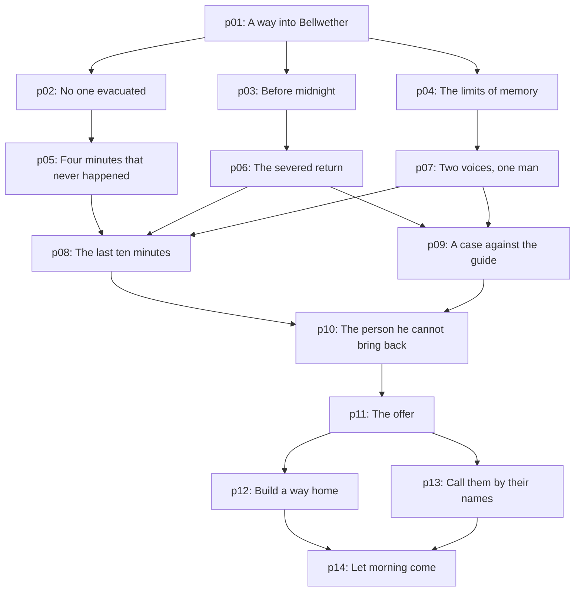

# Puzzle specification — author / facilitator spoilers

This document is generated from the deterministic server episode. Never serve it as a client asset. Run `npm run docs:episode` after content edits.

## p01 · A way into Bellwether

- Act: 1; location: street; interaction: circuit.
- Narrative purpose: Teach proximity, role observations, deliberate sharing and a two-person deduction.
- Initially known: Open the town gate without enrolling anyone in the recording ring. Compare the erased marks with the separate circuits.
- Prerequisites: None; arrival.
- Required contributions: Trace Analyst, Field Engineer.

### Discoverable evidence / exact reasoning

- **The erased outward arrow** (trace, street, boundary): Under the paint, the arrow points OUT. Footprints end at the inner posts, but the road beyond the outer posts carries no repeating trace. The six strangers arrived after the boundary formed.
- **Two separate circuits** (engineer, street, boundary): The gate uses an ordinary municipal battery. The inner posts connect to a separate recording ring. Bridging these circuits would energize the ring; opening only the municipal gate leaves it isolated.

### Solution and feedback

1. Power the gate from: **The municipal battery**
2. Keep this circuit isolated: **The recording ring**

Incorrect attempt: The gate and the recording ring are separate systems. Trace the proposed current before connecting it.

Hints (explicitly requested; unrelated content stays hidden):

1. The painted arrow is not the only arrow.
2. The gate and the recording posts use different supplies.
3. Use the municipal battery. Leave the recording ring isolated.

World change: The municipal gate opens. Police, clinic and archive are accessible. The radio wakes: “You came. There is still time.”

Recovery: observations and shared evidence persist; clues remain at their original objects; the player’s answer draft persists across devices and restarts. Closing or disconnecting consumes nothing. Completed deductions are idempotent. Finale latches remain armed indefinitely. Failed attempts consume no resources.

## p02 · No one evacuated

- Act: 2; location: police; interaction: deduction.
- Narrative purpose: Challenge the radio early with independent evidence.
- Initially known: The radio says the town was evacuated after a fire. Record the account that survives both the dispatch reel and the physical scene.
- Prerequisites: p01
- Required contributions: Audio Specialist, Forensic Investigator.

### Discoverable evidence / exact reasoning

- **Dispatch reel · restored** (audio, police, dispatch): TRANSCRIPT, 23:56: Mara: “Not a fire. A pulse. Kit is upstairs; I’m going back.” Dispatch: “Stay inside.” Three low knocks follow. The evacuation siren is absent. VISUAL: three short low-frequency pulses, no siren band.
- **Dust, not ash** (forensic, police, dispatch): The windowsill holds undisturbed grey paper dust, not combustion ash. The door is bolted from inside. Six unfinished mugs are still warm. A fire evacuation would disturb these surfaces.

### Solution and feedback

1. What happened here?: **An interrupted ordinary night**
2. Strongest corroboration: **Undisturbed dust and no siren**

Incorrect attempt: Test both parts of the claim. A frightening noise alone does not establish a fire or an evacuation.

Hints (explicitly requested; unrelated content stays hidden):

1. Listen for what is absent in the dispatch call.
2. A fire should leave ash and an evacuation should disturb the room.
3. Choose interrupted ordinary night, supported by undisturbed dust and no siren.

World change: The evacuation theory is crossed out. A tower service key is found inside the dispatch drawer.

Recovery: observations and shared evidence persist; clues remain at their original objects; the player’s answer draft persists across devices and restarts. Closing or disconnecting consumes nothing. Completed deductions are idempotent. Finale latches remain armed indefinitely. Failed attempts consume no resources.

## p03 · Before midnight

- Act: 2; location: clinic; interaction: reconstruction.
- Narrative purpose: Introduce residents and distinguish persistent evidence from repeating fragments.
- Initially known: Reconstruct Mara’s interrupted errand and decide which object can preserve a message beyond a repeated moment.
- Prerequisites: p01
- Required contributions: Trace Analyst, Forensic Investigator, Field Engineer.

### Discoverable evidence / exact reasoning

- **Mara’s unfinished journey** (trace, clinic, ward): One set of nurse’s shoe prints travels from the treatment table toward the upstairs ward. They repeat in place at the last step. No track leads out of the clinic. A child’s print waits upstairs.
- **A prepared dose** (forensic, clinic, ward): The syringe holds an ordinary measured insulin dose. Its cap is intact, and the chart says “Kit, before midnight.” No sedative, toxin, or mass illness is present. Mara’s note reads: “Keep the light on. I will be there.”
- **The stopped infusion** (engineer, clinic, ward): A battery infusion timer reads 23:52 and resumes the same single tick. Its independent clock was outside the experiment network. Powered objects repeat, but the unpowered chart is unchanged.

### Solution and feedback

1. Mara was going: **To Kit upstairs**
2. A reliable persistent record: **The unpowered treatment chart**

Incorrect attempt: The dose and its label explain the errand. The timer repeats; not every object can preserve new information.

Hints (explicitly requested; unrelated content stays hidden):

1. Follow the prints, then compare them with the dose.
2. Powered resonant objects repeat; the handwritten chart does not.
3. Mara was going to Kit upstairs. Preserve the unpowered treatment chart.

World change: Mara’s promise enters the case. Her maintenance pass opens the substation path.

Recovery: observations and shared evidence persist; clues remain at their original objects; the player’s answer draft persists across devices and restarts. Closing or disconnecting consumes nothing. Completed deductions are idempotent. Finale latches remain armed indefinitely. Failed attempts consume no resources.

## p04 · The limits of memory

- Act: 2; location: archive; interaction: comparison.
- Narrative purpose: Establish fixed rules and make the motive discoverable well before the reveal.
- Initially known: The council funded a recorder, not a resurrection machine. Reconcile the demonstration, the service notation, and Ada’s dedication.
- Prerequisites: p01
- Required contributions: Cryptographer, Temporal Analyst, Audio Specialist.

### Discoverable evidence / exact reasoning

- **The council’s directional notation** (cipher, archive, ledger): The town’s service ledger uses a circle for the ring, a bar for isolation, and an open chevron for return to the river boundary. RETURN means releasing the recorded interval outward; RESET means recording a fresh interval. These are not synonyms.
- **An empty demonstration chair** (temporal, archive, ledger): An echo shows Voss at the council: “Only those inside the ring when recording begins can be recalled.” The clock reads 23:50. A later fragment shows the same chair empty. Visitors entering after capture are not yet part of it.
- **A dedication, not a test subject** (audio, archive, ledger): RESTORED TAPE: “For Ada. If I could just hear that last afternoon again.” The archival label dates her death eight months ago. The array’s specification says ten-minute recordings only. VISUAL: the speech track is intact beneath a steady mains hum.

### Solution and feedback

1. Who can the first interval contain?: **People inside at 23:50**
2. What does RESET do?: **Makes a new recording**

Incorrect attempt: The archive’s emotional promise cannot extend the machine’s stated recording limits.

Hints (explicitly requested; unrelated content stays hidden):

1. The demonstration defines the boundary. The dedication defines a loss outside it.
2. RESET and RETURN have separate meanings in the service ledger.
3. The first interval contains people inside at 23:50. RESET makes a new recording.

World change: The radio station address is recovered. Ada was never in the interval. Your team is still outside the recording.

Recovery: observations and shared evidence persist; clues remain at their original objects; the player’s answer draft persists across devices and restarts. Closing or disconnecting consumes nothing. Completed deductions are idempotent. Finale latches remain armed indefinitely. Failed attempts consume no resources.

## p05 · Four minutes that never happened

- Act: 3; location: clock; interaction: timeline.
- Narrative purpose: A concrete temporal inconsistency becomes a causal clue.
- Initially known: Align the radio override with Inez’s corrected clock. Then identify which event happened first.
- Prerequisites: p02
- Required contributions: Cryptographer, Temporal Analyst, Trace Analyst.

### Discoverable evidence / exact reasoning

- **Inez’s four-minute correction** (cipher, clock, clockwork): Service log: RADIO SYNC = TRUE TIME + 04:00. The clock face was corrected by Inez; the radio timestamp was not. Subtract four minutes from radio stamps. Her return-gate note is signed 23:58 true time.
- **The gate opened first** (temporal, clock, clockwork): Inez opens the outward gate at 23:58 by the corrected face. One minute later, an override pulse turns every hand toward midnight. Her action precedes the override; it does not cause it.
- **The path Inez left** (trace, clock, clockwork): A luminous disturbance leads from the clock’s open return gate toward the street boundary. Its repeating motion travels outward. The forward path points the opposite way and ends at the chamber.

### Solution and feedback

1. 00:03 on the radio is actually: **23:59**
2. Earlier event: **Inez opens the return gate**

Incorrect attempt: Use the same clock standard for both events. The service log gives the direction of the correction.

Hints (explicitly requested; unrelated content stays hidden):

1. Inez corrected the tower, not the radio.
2. Radio timestamps run four minutes fast. Her gate note uses true time.
3. 00:03 radio means 23:59. Inez opened the gate at 23:58, before the override.

World change: The clocks align. Inez attempted a rescue before the disaster. An outward path still exists.

Recovery: observations and shared evidence persist; clues remain at their original objects; the player’s answer draft persists across devices and restarts. Closing or disconnecting consumes nothing. Completed deductions are idempotent. Finale latches remain armed indefinitely. Failed attempts consume no resources.

## p06 · The severed return

- Act: 3; location: power; interaction: forensics.
- Narrative purpose: Require three complementary roles to establish deliberate physical causation.
- Initially known: Determine whether the safety failure was accidental. Choose both the mechanism and the evidence that links a person to it.
- Prerequisites: p03
- Required contributions: Field Engineer, Forensic Investigator, Trace Analyst.

### Discoverable evidence / exact reasoning

- **A deliberate cut** (engineer, power, conductor): A sharp tool cut the RETURN conductor while the FORWARD supply stayed live. No overload scars. A repaired bridge conducts in both directions: if FORWARD remains live, it feeds the ring again. The remote gate must remain closed until the repaired return can carry current. Compare its route with the trace at the clock.
- **The cutter and the blood** (forensic, power, conductor): Voss’s tagged insulated cutter fits the clean cut. A fresh smear on its handle matches the wound visible in the chamber’s physical access photograph. The safety wire was cut by a person; Inez’s distant clock control cannot cut it.
- **One arrival at the cable** (trace, power, conductor): Voss’s distinctive damaged left heel approaches the conductor, stops, and returns to the chamber. The maintenance dust contains no other fresh approach. The cutter was not planted after the capture: there are no later tracks.

### Solution and feedback

1. Failure mechanism: **The return was deliberately cut**
2. Physical attribution: **Voss’s cutter and matching approach**

Incorrect attempt: An accusation is not physical attribution. Combine damage, tool and route.

Hints (explicitly requested; unrelated content stays hidden):

1. An overload and a tool leave different damage.
2. The cutter alone might move; the undisturbed approach trace constrains that theory.
3. The return was deliberately cut. Voss’s cutter and matching approach identify him.

World change: The team identifies sabotage. The forward supply remained live while the safe return was severed.

Recovery: observations and shared evidence persist; clues remain at their original objects; the player’s answer draft persists across devices and restarts. Closing or disconnecting consumes nothing. Completed deductions are idempotent. Finale latches remain armed indefinitely. Failed attempts consume no resources.

## p07 · Two voices, one man

- Act: 3; location: radio; interaction: signal.
- Narrative purpose: Reveal identity through overlapping, independently checkable audio and cryptography.
- Initially known: The radio offers help. Separate its newer instructions from the underlying abort and authenticate the speaker using a second source.
- Prerequisites: p04
- Required contributions: Audio Specialist, Cryptographer.

### Discoverable evidence / exact reasoning

- **A voice across the carrier** (audio, radio, broadcast): ISOLATED TRACKS: a faint original voice says “Abort. Carry the return outward.” Over it, the guide says “Restart. I can bring everyone back.” The guide and the archive dedication share the same breath, cadence and clipped final consonants.
- **The authenticated override** (cipher, radio, broadcast): The radio log signs the override E.VOSS at 00:03 RADIO TIME. Inez’s key can open RETURN only; it cannot authorize FORWARD or OVERRIDE. “Rescue protocol” was added to the restart instructions after the signature.
- **A dedication, not a test subject** (audio, archive, ledger): RESTORED TAPE: “For Ada. If I could just hear that last afternoon again.” The archival label dates her death eight months ago. The array’s specification says ten-minute recordings only. VISUAL: the speech track is intact beneath a steady mains hum.

### Solution and feedback

1. The guide is: **Elian Voss**
2. Original instruction underneath: **Carry the return outward**

Incorrect attempt: Use the authenticated log and the restored voice together; the loudest layer is not the oldest.

Hints (explicitly requested; unrelated content stays hidden):

1. Compare the restored dedication with the carrier voice.
2. The signature independently identifies who could issue an override.
3. The guide is Voss. The original track says carry the return outward.

World change: The guide is Voss. Beneath his promise, the original abort survives. The underground access unlocks when the three branch findings are complete.

Recovery: observations and shared evidence persist; clues remain at their original objects; the player’s answer draft persists across devices and restarts. Closing or disconnecting consumes nothing. Completed deductions are idempotent. Finale latches remain armed indefinitely. Failed attempts consume no resources.

## p08 · The last ten minutes

- Act: 3; location: chamber; interaction: timeline.
- Narrative purpose: Integrate three parallel branches into one chronology.
- Initially known: Place the four decisive events in true chronological order. Use the corrected clock, not the printed radio stamp.
- Prerequisites: p05, p06, p07
- Required contributions: Temporal Analyst, Cryptographer, Field Engineer.

### Discoverable evidence / exact reasoning

- **A sequence across the fracture** (temporal, chamber, array): Three fragments arrive out of order. Voss presses OVERRIDE beside a radio monitor reading 00:03. In another fragment, the recording lamp starts beside the municipal face at 23:50. A third shows a severed-return alert marked 23:57 on a maintenance receipt. The clock gate is outside this camera’s view. Compare the clockkeeper’s observation and the radio correction before ordering these events.
- **Inez’s four-minute correction** (cipher, clock, clockwork): Service log: RADIO SYNC = TRUE TIME + 04:00. The clock face was corrected by Inez; the radio timestamp was not. Subtract four minutes from radio stamps. Her return-gate note is signed 23:58 true time.
- **A deliberate cut** (engineer, power, conductor): A sharp tool cut the RETURN conductor while the FORWARD supply stayed live. No overload scars. A repaired bridge conducts in both directions: if FORWARD remains live, it feeds the ring again. The remote gate must remain closed until the repaired return can carry current. Compare its route with the trace at the clock.
- **The gate opened first** (temporal, clock, clockwork): Inez opens the outward gate at 23:58 by the corrected face. One minute later, an override pulse turns every hand toward midnight. Her action precedes the override; it does not cause it.

### Solution and feedback

1. Event 1: **Recording begins**
2. Event 2: **Voss cuts the return**
3. Event 3: **Inez opens return**
4. Event 4: **Voss overrides the abort**

Incorrect attempt: One event is out of causal order. Compare the severed-return alert with the corrected gate and override times.

Hints (explicitly requested; unrelated content stays hidden):

1. Recording begins before any sabotage.
2. The cable is cut at 23:57, Inez acts at 23:58, and override is 23:59.
3. Order: recording begins → Voss cuts return → Inez opens return → Voss overrides abort.

World change: The sequence is reconstructed: 23:50 record; 23:57 sabotage; 23:58 attempted return; 23:59 override; midnight capture.

Recovery: observations and shared evidence persist; clues remain at their original objects; the player’s answer draft persists across devices and restarts. Closing or disconnecting consumes nothing. Completed deductions are idempotent. Finale latches remain armed indefinitely. Failed attempts consume no resources.

## p09 · A case against the guide

- Act: 3; location: police; interaction: deduction.
- Narrative purpose: Avoid making a voice match alone sufficient proof of culpability.
- Initially known: Build a defensible account of responsibility. The evidence must establish both physical sabotage and authority over the experiment.
- Prerequisites: p06, p07
- Required contributions: Forensic Investigator, Trace Analyst, Cryptographer.

### Discoverable evidence / exact reasoning

- **The cutter and the blood** (forensic, power, conductor): Voss’s tagged insulated cutter fits the clean cut. A fresh smear on its handle matches the wound visible in the chamber’s physical access photograph. The safety wire was cut by a person; Inez’s distant clock control cannot cut it.
- **One arrival at the cable** (trace, power, conductor): Voss’s distinctive damaged left heel approaches the conductor, stops, and returns to the chamber. The maintenance dust contains no other fresh approach. The cutter was not planted after the capture: there are no later tracks.
- **The authenticated override** (cipher, radio, broadcast): The radio log signs the override E.VOSS at 00:03 RADIO TIME. Inez’s key can open RETURN only; it cannot authorize FORWARD or OVERRIDE. “Rescue protocol” was added to the restart instructions after the signature.

### Solution and feedback

1. Responsible person: **Elian Voss**
2. Independent pair of proofs: **Cutter approach + signed override**

Incorrect attempt: A clock error explains a misleading timestamp, not a severed wire or an authorized override.

Hints (explicitly requested; unrelated content stays hidden):

1. Distinguish who could open a gate from who could authorize forward capture.
2. The cable scene establishes physical action; the radio log establishes authority.
3. Elian Voss: cutter approach plus signed override.

World change: The case links Voss to both sabotage and capture. Inez and Mara are cleared.

Recovery: observations and shared evidence persist; clues remain at their original objects; the player’s answer draft persists across devices and restarts. Closing or disconnecting consumes nothing. Completed deductions are idempotent. Finale latches remain armed indefinitely. Failed attempts consume no resources.

## p10 · The person he cannot bring back

- Act: 4; location: archive; interaction: comparison.
- Narrative purpose: Give the antagonist an understandable motive without excusing the harm.
- Initially known: Explain why Voss needs the investigators and why the promised rescue cannot achieve his private goal.
- Prerequisites: p08, p09
- Required contributions: Audio Specialist, Forensic Investigator.

### Discoverable evidence / exact reasoning

- **A dedication, not a test subject** (audio, archive, ledger): RESTORED TAPE: “For Ada. If I could just hear that last afternoon again.” The archival label dates her death eight months ago. The array’s specification says ten-minute recordings only. VISUAL: the speech track is intact beneath a steady mains hum.
- **Voss’s final rehearsal** (audio, chamber, array): RESTORED PRIVATE MEMO: “Ada was never in the first recording. I know. Another cycle, perhaps a longer one. Six people on the outside can rearm the paths. I can tell them it is a rescue.” The carrier cannot move physical switches outside the recording.
- **The people inside** (forensic, chamber, array): The occupancy roll lists Mara Vale, Kit Mercer, Inez Reed and 184 other living residents at 23:50. Ada Voss is not on it. The array has neither her body nor any recording of her lifetime. Address the living occupancy roll, not Voss’s memorial.

### Solution and feedback

1. His private goal: **Recover Ada**
2. The fatal contradiction: **Ada died before any recording**

Incorrect attempt: A longer or repeated capture cannot add someone who was never recorded. Read the occupancy roll against the memorial.

Hints (explicitly requested; unrelated content stays hidden):

1. His private memo changes how the dedication reads.
2. Compare Ada’s death date with the first recording boundary.
3. He wants Ada back, but she died before any recording.

World change: Voss wanted another chance with his daughter. The machine could never give it to him. He needs unrecorded hands to restart it.

Recovery: observations and shared evidence persist; clues remain at their original objects; the player’s answer draft persists across devices and restarts. Closing or disconnecting consumes nothing. Completed deductions are idempotent. Finale latches remain armed indefinitely. Failed attempts consume no resources.

## p11 · The offer

- Act: 4; location: chamber; interaction: decision.
- Narrative purpose: Offer a fair recoverable misleading choice with a visible consequence.
- Initially known: “Restart it. Please. I can still fix this.” The console offers two routes. Decide what the evidence supports. A safety trip protects the first mistaken restart.
- Prerequisites: p10
- Required contributions: Trace Analyst, Field Engineer, Cryptographer, Temporal Analyst.

### Discoverable evidence / exact reasoning

- **A new boundary preview** (trace, chamber, array): The RESTART preview includes six new silhouettes standing where the investigators now stand. The existing residents remain in the same inner band. Nothing in the preview travels outward.
- **The safety trip remains** (engineer, chamber, array): The original overload trip is intact. A restart attempt will isolate the ring before capture and show its proposed subjects. Resetting the trip does not erase evidence. Reversal uses the RETURN bus; restart always uses FORWARD.
- **The council’s directional notation** (cipher, archive, ledger): The town’s service ledger uses a circle for the ring, a bar for isolation, and an open chevron for return to the river boundary. RETURN means releasing the recorded interval outward; RESET means recording a fresh interval. These are not synonyms.
- **A stable latch** (temporal, chamber, array): The six return latches hold until deliberately changed. Their order is irrelevant, provided each is configured to the same pre-override state: Inez’s gate at 23:58 true time. The return releases the last recorded positions into present time; it does not resurrect anyone.

### Solution and feedback

1. Choose a protocol: **Reverse through the return**
2. Who belongs in the return?: **The original recorded residents**

Incorrect attempt: The proposed capture includes six new silhouettes. The trip isolates the ring. No progress is lost. Reconsider the meaning of RESET and RETURN.

Hints (explicitly requested; unrelated content stays hidden):

1. Study the six extra silhouettes before trusting the label “rescue”.
2. Restart records again. Return sends the original interval outward through Inez’s gate.
3. Reverse through the return, addressed to the original recorded residents.

World change: The forward protocol is rejected. The return manifold wakes. Six stable latches await a deliberate configuration.

Recovery: observations and shared evidence persist; clues remain at their original objects; the player’s answer draft persists across devices and restarts. Closing or disconnecting consumes nothing. Completed deductions are idempotent. Finale latches remain armed indefinitely. Failed attempts consume no resources.

## p12 · Build a way home

- Act: 4; location: power; interaction: circuit.
- Narrative purpose: Apply a known electrical rule rather than introduce a finale exception.
- Initially known: Restore the physical return path in a safe sequence. An outward gate cannot help while the forward supply still drives the ring.
- Prerequisites: p11
- Required contributions: Field Engineer, Trace Analyst, Cryptographer.

### Discoverable evidence / exact reasoning

- **A deliberate cut** (engineer, power, conductor): A sharp tool cut the RETURN conductor while the FORWARD supply stayed live. No overload scars. A repaired bridge conducts in both directions: if FORWARD remains live, it feeds the ring again. The remote gate must remain closed until the repaired return can carry current. Compare its route with the trace at the clock.
- **The path Inez left** (trace, clock, clockwork): A luminous disturbance leads from the clock’s open return gate toward the street boundary. Its repeating motion travels outward. The forward path points the opposite way and ends at the chamber.
- **How the return is addressed** (cipher, chamber, array): The return manifold accepts the municipal occupancy roll plus the open-chevron OUT route. A memorial archive is a reference, not an occupied address. A closed circle routes the interval back into itself.

### Solution and feedback

1. Service step 1: **Isolate forward**
2. Service step 2: **Bridge return**
3. Service step 3: **Open outward gate**

Incorrect attempt: That order could feed the ring before a safe return exists. The diagnostic explicitly describes the hazard.

Hints (explicitly requested; unrelated content stays hidden):

1. Read the conductor diagnosis before bridging anything.
2. Remove the source that would feed the ring; then repair the route; then open it.
3. Isolate forward → bridge return → open outward gate.

World change: The repaired return glows toward the street. Power flows into the safe path. The first dawn-colored light touches the cables.

Recovery: observations and shared evidence persist; clues remain at their original objects; the player’s answer draft persists across devices and restarts. Closing or disconnecting consumes nothing. Completed deductions are idempotent. Finale latches remain armed indefinitely. Failed attempts consume no resources.

## p13 · Call them by their names

- Act: 4; location: clinic; interaction: address.
- Narrative purpose: Turn technical addressing into an emotionally grounded act.
- Initially known: Prepare the return message. Who are you calling, and which surviving signal can carry the original abort?
- Prerequisites: p11
- Required contributions: Forensic Investigator, Cryptographer, Audio Specialist.

### Discoverable evidence / exact reasoning

- **The people inside** (forensic, chamber, array): The occupancy roll lists Mara Vale, Kit Mercer, Inez Reed and 184 other living residents at 23:50. Ada Voss is not on it. The array has neither her body nor any recording of her lifetime. Address the living occupancy roll, not Voss’s memorial.
- **How the return is addressed** (cipher, chamber, array): The return manifold accepts the municipal occupancy roll plus the open-chevron OUT route. A memorial archive is a reference, not an occupied address. A closed circle routes the interval back into itself.
- **A prepared dose** (forensic, clinic, ward): The syringe holds an ordinary measured insulin dose. Its cap is intact, and the chart says “Kit, before midnight.” No sedative, toxin, or mass illness is present. Mara’s note reads: “Keep the light on. I will be there.”
- **A voice across the carrier** (audio, radio, broadcast): ISOLATED TRACKS: a faint original voice says “Abort. Carry the return outward.” Over it, the guide says “Restart. I can bring everyone back.” The guide and the archive dedication share the same breath, cadence and clipped final consonants.

### Solution and feedback

1. Address source: **The 23:50 occupancy roll**
2. Carrier: **The original abort beneath the guide**

Incorrect attempt: The return must address real occupants through an existing signal. Neither the memorial nor an absent siren can do that.

Hints (explicitly requested; unrelated content stays hidden):

1. The destination is people who were present, not people who are remembered.
2. The original abort was never erased; it remains under the guide’s stronger layer.
3. Use the 23:50 occupancy roll and the original abort beneath the guide.

World change: Mara. Kit. Inez. One hundred and eighty-four more names. The carrier answers, faintly: “We’re here.”

Recovery: observations and shared evidence persist; clues remain at their original objects; the player’s answer draft persists across devices and restarts. Closing or disconnecting consumes nothing. Completed deductions are idempotent. Finale latches remain armed indefinitely. Failed attempts consume no resources.

## p14 · Let morning come

- Act: 5; location: chamber; interaction: finale.
- Narrative purpose: Use every established ability and the shared explanation in stable distributed coordination.
- Initially known: Take your six established tools to six return stations. Each latch holds; talk through the configuration, then arm it. There is no countdown.
- Prerequisites: p12, p13
- Required contributions: Trace Analyst, Audio Specialist, Cryptographer, Field Engineer, Forensic Investigator, Temporal Analyst.

### Discoverable evidence / exact reasoning

- **The erased outward arrow** (trace, street, boundary): Under the paint, the arrow points OUT. Footprints end at the inner posts, but the road beyond the outer posts carries no repeating trace. The six strangers arrived after the boundary formed.
- **A voice across the carrier** (audio, radio, broadcast): ISOLATED TRACKS: a faint original voice says “Abort. Carry the return outward.” Over it, the guide says “Restart. I can bring everyone back.” The guide and the archive dedication share the same breath, cadence and clipped final consonants.
- **How the return is addressed** (cipher, chamber, array): The return manifold accepts the municipal occupancy roll plus the open-chevron OUT route. A memorial archive is a reference, not an occupied address. A closed circle routes the interval back into itself.
- **A deliberate cut** (engineer, power, conductor): A sharp tool cut the RETURN conductor while the FORWARD supply stayed live. No overload scars. A repaired bridge conducts in both directions: if FORWARD remains live, it feeds the ring again. The remote gate must remain closed until the repaired return can carry current. Compare its route with the trace at the clock.
- **The people inside** (forensic, chamber, array): The occupancy roll lists Mara Vale, Kit Mercer, Inez Reed and 184 other living residents at 23:50. Ada Voss is not on it. The array has neither her body nor any recording of her lifetime. Address the living occupancy roll, not Voss’s memorial.
- **A stable latch** (temporal, chamber, array): The six return latches hold until deliberately changed. Their order is irrelevant, provided each is configured to the same pre-override state: Inez’s gate at 23:58 true time. The return releases the last recorded positions into present time; it does not resurrect anyone.

### Solution and feedback

- trace at street: **Outward, along Inez’s path**. Which disturbance carries the town beyond the boundary?
- audio at radio: **The original abort beneath it**. Choose the recovered signal to carry to the return bus.
- cipher at archive: **OUT / open return**. Translate the service chevron into a manifold route.
- engineer at power: **The forward supply**. What must stay isolated while the repaired return carries the town?
- forensic at clinic: **The 23:50 living occupancy roll**. Which people can this interval actually release?
- temporal at clock: **23:58 true time**. Align with the corrected moment when Inez opened return.

Incorrect attempt: Every return station must be configured by its investigator.

Hints (explicitly requested; unrelated content stays hidden):

1. The six stations match the six things you have already learned.
2. Find your role’s station on the map. Correct configurations stay armed while others work.
3. Trace: street/outward. Audio: radio/original abort. Cipher: archive/OUT. Engineer: power/isolate forward. Forensic: clinic/living roll. Temporal: clock/23:58.

World change: The town returns to the present. For the first time in a very long night, the clock moves on.

Recovery: observations and shared evidence persist; clues remain at their original objects; the player’s answer draft persists across devices and restarts. Closing or disconnecting consumes nothing. Completed deductions are idempotent. Finale latches remain armed indefinitely. Failed attempts consume no resources.

